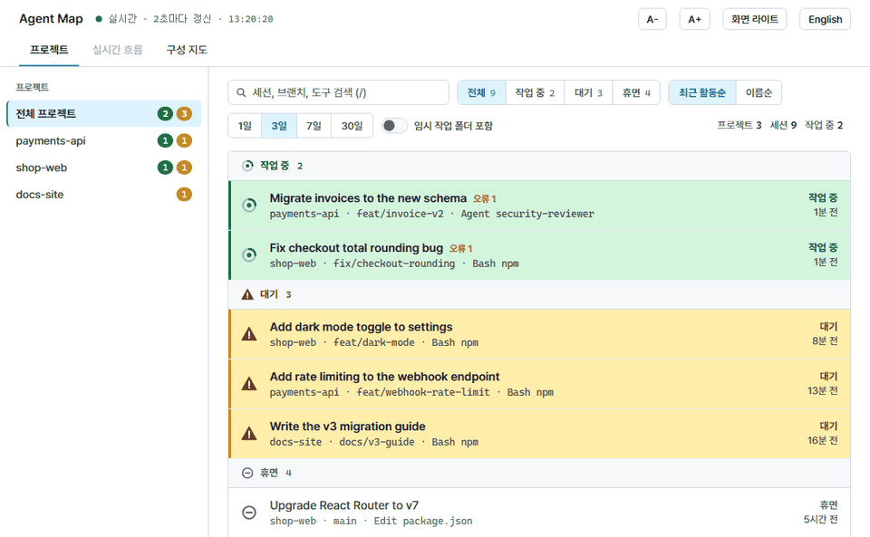
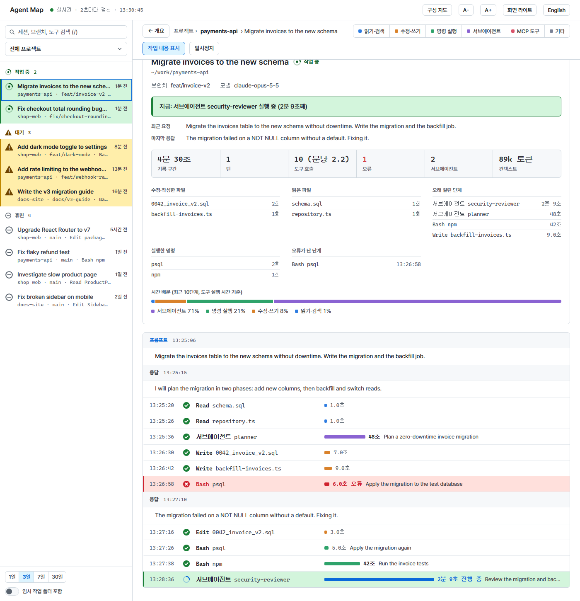

<div align="center">

# agent-map

**지금 Claude Code 세션이 무엇을 하고 있는지 한눈에 보는 실시간 대시보드**

[English](README.md) · 한국어

[](https://github.com/sgustjd2/agent-map/releases)
[](LICENSE)




</div>

내 로컬 Claude Code를 한눈에 보는 플러그인입니다. 세션 여러 개를 동시에 돌리다 보면 "어느 창이 아직 일하고 있고, 어느 창이 내 입력을 기다리는지" 헷갈립니다. agent-map은 이걸 한 화면에 모아 보여줍니다. 두 가지 화면이 있습니다.

- **구성 지도 (`/agent-map`)**: 사용자, 프로젝트, 플러그인에 설치된 스킬·에이전트·커맨드·훅·MCP 서버를 한 화면에 보여줍니다.
- **실시간 대시보드 (`/agent-map:live`)**: 프로젝트별로 지금 어떤 작업이 돌아가는지, 세션의 작업 흐름이 어떻게 이어지는지 보여주고, 안 쓰는 세션을 정리할 수 있습니다.

두 화면 모두 외부 서비스를 쓰지 않고, 이 컴퓨터의 파일만 읽습니다. 모델 토큰도 쓰지 않습니다.

---

## 설치

팀원 각자 Claude Code에서 아래 두 줄을 실행합니다.

```
/plugin marketplace add sgustjd2/agent-map
/plugin install agent-map@agent-map
```

업데이트는 마켓플레이스를 갱신한 뒤 다시 설치합니다.

```
/plugin marketplace update agent-map
/plugin update agent-map@agent-map
```

설치 후 Claude Code를 재시작해야 새 명령이 보입니다. Node 18 이상이 필요합니다.

버전 목록과 변경 내용은 [릴리스 페이지](https://github.com/sgustjd2/agent-map/releases)에서 볼 수 있습니다.

---

## 구성 지도 (`/agent-map`)

`/agent-map`을 실행하면 로컬을 스캔해 HTML을 만들고 기본 브라우저로 엽니다. 터미널에는 그룹별 개수가 출력됩니다.

- **그룹:** 사용자(`~/.claude`), 현재 프로젝트(`.claude`, `.mcp.json`), 설치된 플러그인(비활성 표시)
- **종류 필터:** 전체, 스킬, 에이전트, 커맨드, 훅, MCP 서버. 칩에 항목 수가 붙습니다
- **범위 필터:** 전체, 사용자, 프로젝트, 플러그인. "비활성 플러그인 포함" 스위치
- **검색:** 이름과 설명으로 찾습니다. `/` 키로 바로 이동합니다
- **상세 패널:** 카드를 누르면 설명, 호출 방법(`/review-pr`처럼 복사 가능), 인자, 허용 도구, 파일 위치가 나옵니다. 훅은 발동 시점과 대상 도구를 한국어로 풀어 보여줍니다
- **언어:** 한국어와 영어. 브라우저 언어를 따라가며 헤더 버튼으로 바꿉니다
- **화면 모드:** 소프트(기본), 라이트, 다크. 헤더 버튼으로 바꾸고 기억합니다. 글자 크기는 `A-` `A+`로 조절합니다
- **구성 지도 버튼:** 실시간 대시보드 헤더에서도 같은 화면으로 오갈 수 있습니다

보안: MCP와 훅은 이름, 주소(쿼리와 계정 정보 제거), 실행 파일 이름만 표시합니다. 인자, 환경변수, 헤더는 읽지 않습니다. HTML은 `~/.claude/agent-map/`에 저장되고 외부로 보내지 않습니다.

스캔만 하려면: `node scripts/agent-map.mjs --no-open`

---

## 실시간 대시보드 (`/agent-map:live`)

`/agent-map:live`를 실행하면 이 컴퓨터에서만 열리는 작은 서버를 띄우고 브라우저로 엽니다. 2초마다 갱신하고, 서버는 30분 동안 접속이 없으면 자동으로 꺼집니다.

### 세션 사이드바
왼쪽에 세션이 상태별로 묶여 나오고, 세션을 누르면 오른쪽에 그 세션의 작업 흐름이 바로 열립니다. 프로젝트는 사이드바 위의 선택 메뉴(작업 중·대기 개수 표시)로 고르고, 아무것도 고르지 않았을 때는 오른쪽에 상태별 세션 수가 보입니다.

- 세션은 **작업 중 → 대기 → 휴면** 묶음으로 나뉘고, 한 줄에 제목, 프로젝트·브랜치·마지막 도구, 마지막 활동 시각이 나옵니다. 지금 보고 있는 세션은 파란 테두리로 표시됩니다. 상태는 색뿐 아니라 아이콘 모양(진행 링, 경고 삼각형, 빈 원)과 글자로도 구분합니다
- **확인이 필요한 세션이 먼저 눈에 들어오게:** 작업 중은 초록, 입력 대기는 노란색으로 행 전체를 칠하고 왼쪽에 굵은 띠를 붙입니다. 라이트·소프트·다크 모두 같습니다. 휴면은 흐리게 두고 4개만 보여준 뒤 `더 보기`로 펼칩니다
- 오류가 난 세션은 제목 옆에 `오류 N`이 붙습니다
- 프로젝트를 고르고 세션을 선택하지 않으면 오른쪽 상단에 **폴더 열기**(폴더가 삭제됐으면 가장 가까운 상위 폴더를 엽니다), **경로 복사**, **많이 쓴 도구** 막대, **사용한 스킬**이 나옵니다
- 사이드바에서 검색, 프로젝트, 기간(1·3·7·30일), 임시 작업 폴더 포함 여부를 고릅니다. 휴면 세션에 마우스를 올리면 삭제 버튼이 나옵니다

### 실시간 흐름
세션을 누르면 작업 흐름이 시간순으로 보입니다. 한 줄이 한 단계이고, 막대 길이가 걸린 시간입니다.



- **지금 상태:** `지금: 서브에이전트 security-reviewer 실행 중 (2분 56초째)`처럼 현재 하는 일을 한 줄로 보여줍니다. 입력을 기다리는 중이면 노란 띠로 `입력 대기`라고 알려주고, 응답이 오래 없으면 권한 승인을 기다리는 중일 수 있다고 안내합니다
- 각 단계는 성공(체크), 진행 중(링), 오류(X) 아이콘이 붙고 오류 행은 붉게 칠합니다. 가장 오래 걸린 3개 단계는 시간이 굵게 표시됩니다
- **요약 수치:** 기록 구간, 턴 수, 도구 호출 수(분당 평균), 오류 수, 서브에이전트 수, 컨텍스트 토큰 수
- **시간 배분:** 명령 실행, MCP 도구, 읽기·검색, 수정·쓰기 등 도구 종류별 시간 비율
- **정보 묶음:** 수정·작성한 파일, 읽은 파일, 오래 걸린 단계, 실행한 명령, 사용한 MCP 서버, 오류가 난 단계
- **흐름:** 프롬프트와 응답은 구분선으로, 도구 호출은 한 줄씩 나옵니다. 같은 도구가 연속되면 `×3`처럼 묶습니다
- **조작:** 일시정지, 도구 종류별 강조, 새 단계가 생기면 `새 단계 N개 · 최신으로` 버튼
- **작업 내용 표시 (스위치, 기본 켜짐):** 무슨 요청으로 무슨 작업을 했는지 볼 수 있습니다.
  - 요약에 `최근 요청`과 `마지막 응답`이 나오고, 프롬프트와 응답의 첫 줄이 인용 블록으로 흐름 사이에 들어갑니다
  - 명령·서브에이전트 단계에는 모델이 붙인 한 줄 설명(예: `로그인 컴포넌트 테스트 실행`)이 막대 옆에 나옵니다
  - 시스템이 끼워 넣는 문맥(`<system-reminder>` 등)은 걸러냅니다
  - **이 컴퓨터에서 연 화면에만 보입니다.** 다른 기기(LAN)로 접속하면 이 내용은 서버가 보내지 않습니다
  - 스위치를 끄면 서버에 내용을 요청하지도 않습니다. 화면을 공유할 때는 꺼 두세요
- 명령어 인자, 도구 출력, 파일 내용은 읽지 않습니다

### 세션 삭제·정리
안 쓰는 휴면 세션을 정리할 수 있습니다.

- **진입:** 프로젝트를 고른 뒤 `휴면 세션 정리…`, 휴면 행에 마우스를 올렸을 때 나오는 `삭제…`, 또는 세션 상세 화면의 `이 세션 삭제…`
- **선택:** 체크박스로 고릅니다. `작은 세션 선택`은 내용이 거의 없는 세션을 한 번에 고릅니다
- **기본 동작 (휴지통 이동):** 선택한 세션의 기록 파일과 하위 폴더를 `~/.claude/agent-map-trash/`로 옮깁니다. 이 폴더에서 되돌릴 수 있습니다
- **영구 삭제:** 스위치를 켜면 휴지통을 거치지 않고 바로 지웁니다. 버튼을 두 번 눌러야 실행됩니다
- **휴지통 비우기:** 휴지통에 항목이 있으면 도구줄에 링크가 나타납니다. 영구 삭제라서 한 번 더 확인합니다
- **안전장치:**
  - 최근 30분 안에 쓴 세션은 옮기거나 지우지 않습니다
  - 프로젝트 폴더의 코드와 파일은 건드리지 않습니다. 세션 기록(`~/.claude/projects` 안)만 대상입니다
  - 경로 탈출(`..`)과 잘못된 이름은 서버가 거부합니다
  - 쓰기 요청은 커스텀 헤더가 있어야 하므로 다른 웹사이트가 몰래 호출할 수 없습니다

**주의:** 정리한 세션은 `claude --resume` 목록에서 사라집니다. 휴지통으로 옮긴 세션은 폴더에서 되돌리면 다시 보입니다. 처음에는 휴지통 이동으로 시작하시길 권합니다.

### 구성 지도 탭
같은 서버의 `/map`에서 열립니다. 방문할 때마다 최신 상태로 새로 만듭니다.

### 키보드
`/` 검색, `Esc` 뒤로 또는 검색 지우기, 방향키로 탭 이동.

---

## 같은 네트워크의 다른 기기에서 보기

기본은 이 컴퓨터(`127.0.0.1`)에서만 열립니다. 다른 기기에서도 보려면 `--lan`으로 실행합니다.

```
node scripts/live.mjs --lan
```

실행하면 접속 주소가 출력됩니다(예: `http://192.168.1.112:7788/`).

- **같은 네트워크만:** 접속한 기기의 주소가 이 컴퓨터와 같은 사설 네트워크(서브넷)일 때만 허용합니다. 다른 네트워크와 인터넷은 403으로 거부합니다
- **읽기 전용:** 다른 기기에서 접속하면 보기만 됩니다. 폴더 열기, 세션 정리, 휴지통 비우기, 서버 종료는 서버가 거부하고 화면에서도 숨겨집니다
- **이 컴퓨터는 예외:** 이 PC의 브라우저가 자기 LAN 주소로 접속해도 이 컴퓨터로 취급해 전체 기능을 씁니다. 다른 기기는 이 PC의 주소를 흉내 낼 수 없습니다
- **접근 토큰(선택):** `--lan --token`으로 실행하면 무작위 토큰이 포함된 주소로만 들어갑니다. 토큰은 HttpOnly 쿠키로 유지됩니다. 틀린 토큰을 10번 보내면 해당 기기를 5분간 차단합니다

**주의:**
- 같은 네트워크에 있는 사람은 프로젝트 경로와 세션 제목을 볼 수 있습니다
- HTTPS가 아니라서 내용이 네트워크에서 그대로 오갑니다. 공용 와이파이에서는 쓰지 마세요
- Windows 방화벽이 처음에 node.exe 허용을 물으면 **사설 네트워크만** 허용하세요
- 끝나면 `node scripts/live.mjs --stop`으로 끄세요

---

## 개인정보와 보안 요약

- 읽는 것: `~/.claude/projects`의 세션 기록 끝부분과 플러그인·설정 파일의 이름, 주소, 실행 파일 이름
- 이 컴퓨터의 화면에만 보내는 것(스위치로 끌 수 있음): 프롬프트와 응답의 첫 줄, 명령·서브에이전트 단계의 한 줄 설명
- 읽지 않는 것: 명령어 인자, 도구 출력, 파일 내용, 환경변수, 헤더
- 외부 전송: 없음. 모델 호출도 없음
- 서버: 기본은 `127.0.0.1` 전용. 다른 Host 헤더는 거부. 다른 사이트가 화면을 iframe으로 끼워 넣을 수 없음
- `--lan`으로 접속한 다른 기기에는 구성 지도(`/map`)를 보여주지 않습니다. 대시보드만 읽기 전용으로 보입니다
- 쓰기 동작: 커스텀 헤더 필요, 같은 네트워크의 다른 기기에서는 금지, 최근 30분 세션 보호
- 세션 제목은 작업 주제가 드러날 수 있으니 화면을 공유할 때 주의하세요

---

## 개발자용: 릴리스 관리

릴리스는 **자동**으로 만들어집니다. `.github/workflows/release.yml`이 main에 올라온 변경에서 `.claude-plugin/plugin.json`의 버전을 읽고, 아직 없는 태그라면 다음을 자동으로 합니다.

1. 태그 `v<버전>` 생성
2. 그 시점의 파일을 묶은 `agent-map-<버전>.zip` 첨부
3. 이전 릴리스 이후 커밋을 모은 릴리스 노트 자동 작성

새 릴리스를 만들려면 **버전을 올리고 main에 푸시**하면 됩니다.

```
# .claude-plugin/plugin.json 의 "version" 을 올린다 (예: 0.7.0 -> 0.7.1)
git commit -am "feat: ... (0.7.1)"
git push
```

같은 버전으로 다시 푸시하면 릴리스를 만들지 않습니다. 실행 내역은 저장소의 Actions 탭에서 볼 수 있습니다. 필요하면 Actions 탭에서 `release`를 수동으로 실행할 수도 있습니다.

**주의:** 설치된 사용자는 `/plugin update`를 해야 새 버전을 받습니다. 캐시가 같은 버전 이름으로 남아 있으면 업데이트되지 않으니, 코드를 고쳤을 때는 반드시 버전을 올리세요.

## 라이선스

[MIT](LICENSE)
