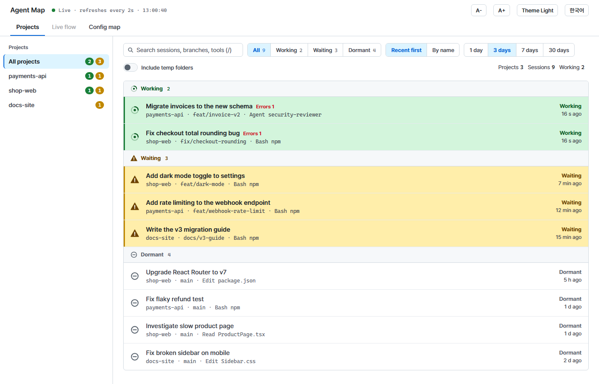
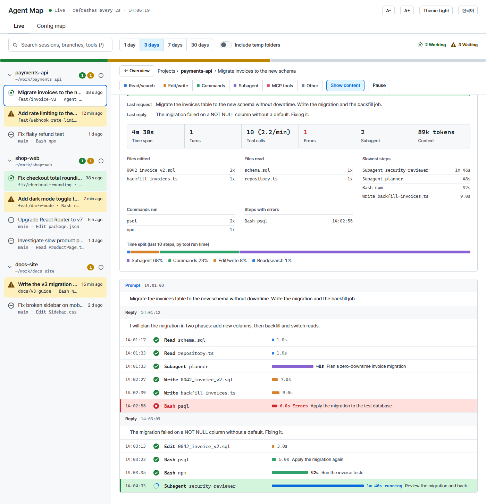
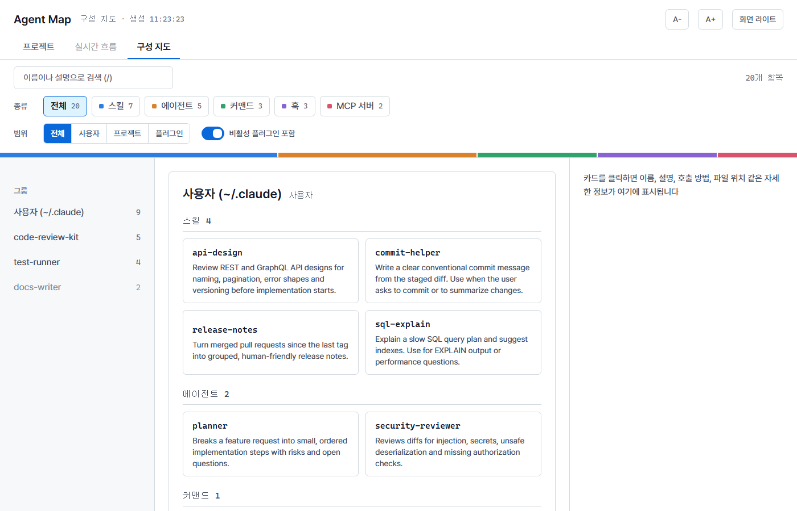
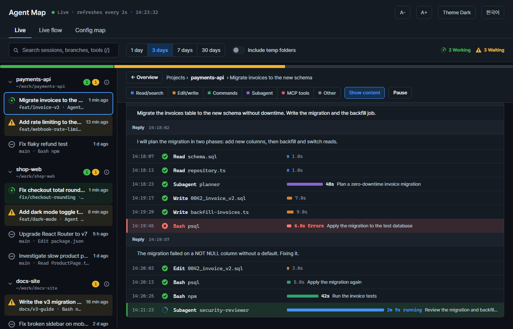

<div align="center">

# agent-map

**A live dashboard for your Claude Code sessions. See which ones are working, which are waiting for you, and what each one just did.**

English · [한국어](README.ko.md)

[](https://github.com/sgustjd2/agent-map/releases)
[](LICENSE)




</div>

Run several Claude Code sessions at once and you lose track: which terminal is still working, which one stopped to ask you something, which one failed ten minutes ago. agent-map reads the session logs Claude Code already writes on your machine and shows them in one page. Nothing leaves your computer and no model tokens are used.

> The UI text is currently Korean. An English UI is on the wish list; the docs and code are in English and Korean.

## Install

In Claude Code:

```
/plugin marketplace add sgustjd2/agent-map
/plugin install agent-map@agent-map
```

Restart Claude Code, then run:

```
/agent-map:live     # live dashboard
/agent-map          # map of your skills, agents, commands, hooks and MCP servers
```

Needs Node 18 or newer. No `npm install`: the plugin has zero dependencies.

Update with `/plugin marketplace update agent-map` and `/plugin update agent-map@agent-map`.

## What it is for

- **Running many sessions.** Waiting sessions are tinted amber and working sessions green, so the ones that need you stand out even at a glance, in light, soft and dark themes.
- **Watching a long task.** The flow view lists every tool call with its duration, flags errors, and says what the session is doing right now.
- **Finding out what happened.** Which files were edited, which commands ran, which step was slow, where it failed.
- **Cleaning up.** Old sessions pile up in `claude --resume`. Select dormant ones and move them to a recoverable trash folder.
- **Knowing your setup.** One map of every skill, agent, command, hook and MCP server from user, project and plugins, with search and plain-language descriptions.

## Screens

| Flow of one session | Config map |
|---|---|
|  |  |

Dark theme:



## Features

**Live dashboard (`/agent-map:live`)**
- Sessions per project, grouped as working, waiting for input, or dormant (no activity for 30 minutes). Status is shown by icon shape and text, not color alone
- Error count per session, last tool used, branch, time since last activity
- Flow view: one row per step with a duration bar, grouped repeats (`x3`), a "now" banner, KPI strip (span, turns, tool calls, errors, subagents, context tokens), most-edited files, slowest steps, commands, MCP servers
- Open a project folder, copy its path, search, filter, sort, 1 to 30 day window
- Three themes, text zoom, keyboard shortcuts (`/` search, `Esc` back)

**Config map (`/agent-map`)**
- Skills, agents, commands, hooks and MCP servers from `~/.claude`, the current project and installed plugins (inactive ones marked)
- Detail panel with how to invoke it, arguments, allowed tools and file location. Hooks are explained in words

**Session cleanup**
- Default is a move to `~/.claude/agent-map-trash`, which you can restore by hand. Permanent delete needs a switch and a second click
- Sessions active in the last 30 minutes are never touched. Only files under `~/.claude/projects` are affected, never your project code

**View from another device (optional)**
- `node scripts/live.mjs --lan` serves the page on your local network, read-only, same subnet only. Add `--token` for a secret link

## Privacy

| | |
|---|---|
| Reads | Tail of session logs in `~/.claude/projects`, plugin and settings files (names, URLs, executable names) |
| Shown on this computer only | First line of prompts and replies, one-line step descriptions. Switchable. The server never sends them to other devices |
| Never read | Command arguments, tool output, file contents, environment variables, headers |
| Sent anywhere | Nothing. No telemetry, no model calls |
| Network | `127.0.0.1` only by default. Write actions need a custom header and are refused for other devices. With `--lan`, other devices get a read-only dashboard; the config map (`/map`) stays local. Pages cannot be framed by other sites |

Session titles can reveal what you work on. Turn the content switch off and mind your screen when sharing.

## How it works

A small Node server (about one file, standard library only) reads the end of each `~/.claude/projects/*/<session>.jsonl`, derives status from file activity and pending tool calls, and serves a single HTML page that polls every 2 seconds. It shuts itself down after 30 minutes without visitors. Stop it with `node scripts/live.mjs --stop`.

Status rules: **working** means the log changed in the last 30 seconds or a tool call is still pending (under 10 minutes). **Waiting** means no activity for under 30 minutes. **Dormant** means 30 minutes or more.

## FAQ

**Does it use my Claude tokens?** No. It only reads local files.

**Does it work with the Claude desktop app?** The plugin installs and runs from Claude Code. It shows whatever session logs exist in `~/.claude/projects`. I have not verified every way of starting a session, so tell me if something is missing.

**Windows, macOS, Linux?** Developed and tested on Windows 11. The code uses only portable Node APIs; "open folder" uses the platform's default file manager.

## Contributing

Issues and pull requests are welcome. Keep it dependency-free. Run the scanner with `node scripts/agent-map.mjs --no-open` and the dashboard with `node scripts/live.mjs --serve`. To record screenshots from fake data instead of your own sessions, see `docs/demo/make-demo-home.mjs`.

Releases are automatic: bump `version` in `.claude-plugin/plugin.json`, push to main, and the workflow tags and publishes it.

## License

[MIT](LICENSE)

If agent-map saves you a few minutes a day, a star on the repo helps others find it.
